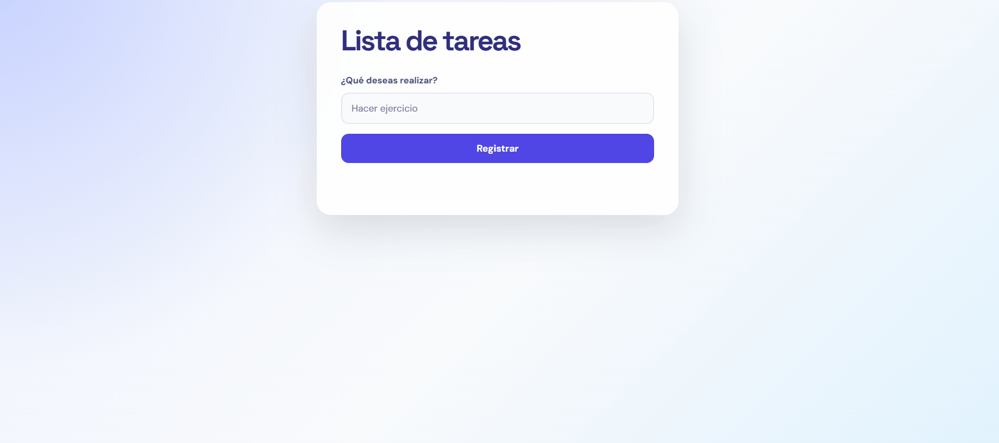

<div align="center">

<div align="center">
  
</div>

## 🌐 Demo

👉 [Ver el proyecto en vivo](https://michael-scs.github.io/toDo-List/)

## 🌟 ¿Qué hace?

| Acción                  | Qué pasa                                    |
| ----------------------- | ------------------------------------------- |
| ➕ **Registrar**        | Agrega una tarea (con el botón o con Enter) |
| ✔️ **Clic en la tarea** | La marca como hecha o la desmarca           |
| 🗑️ **Borrar**           | Elimina esa tarea                           |

- 🚫 No deja registrar tareas vacías ni formadas solo por espacios, y muestra un aviso.
- 💾 Las tareas quedan guardadas en el navegador, así que siguen ahí al recargar la página.
- ♿ Cada botón "Borrar" tiene un `aria-label` con el nombre de su tarea, para quien usa lector de pantalla.

## 🛠️ Tecnologías

- 🧱 **HTML:** formulario, lista y mensajes de aviso
- 🎨 **CSS:** estilo de las tareas hechas
- ⚡ **JavaScript:** manipulación del DOM, eventos, arrays y objetos
- 💾 **localStorage + JSON:** para guardar las tareas en el navegador

## 🚀 Cómo ejecutarlo

1. Clona el repositorio:
   ```bash
   git clone https://github.com/Michael-SCS/toDo-List.git
   ```
2. Entra a la carpeta:
   ```bash
   cd toDo-List
   ```
3. Abre `index.html` en tu navegador 🎉

<details>
<summary>📁 Estructura del proyecto</summary>

```
[nombre-del-repo]/
├── index.html
├── style.css
├── index.js
└── README.md
```

</details>

## 🧠 Cómo funciona

Las tareas se guardan en un **array de objetos**, y la pantalla solo las dibuja a partir de él:

```javascript
{ texto: "Estudiar", hecha: false }
```

Cada vez que algo cambia (agregar, tachar o borrar), el programa actualiza el array, lo guarda en `localStorage` y vuelve a dibujar la lista. Al abrir la página, lee lo guardado y lo dibuja.

## 💡 Lo que aprendí

- 🔎 Array y pantalla: Aprendí que los datos deben vivir en un array y que la pantalla solo los dibuja. Cuando algo cambia, primero se actualiza el array y después se redibuja todo.
- 🐛 El error que más me costó: problemas al cruzar los nombres, el for aveces no corria y quedaba en bucle, y cuando no llamaba bien las funciones y la lista salía vacía al recargar

## 👩‍💻 Autor

<div align="center">
